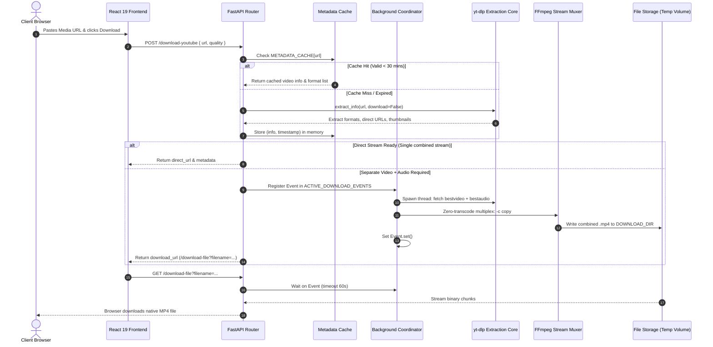
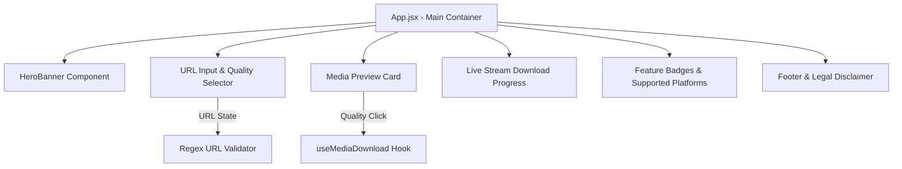

# QuickDownload - Architecture & Data Flow Design

## 1. System Overview
QuickDownload is engineered as an event-driven, decoupled media extraction architecture. The system prioritizes **latency reduction**, **zero-re-encoding stream packaging**, and **resilience against upstream anti-bot measures**.

---

## 2. End-to-End Architectural Diagram

---

## 3. Core Architectural Subsystems

### 3.1 Asynchronous Background Coordination
High-resolution streams on YouTube (1080p, 1440p, 4K) are served as separate video-only and audio-only streams (DASH/HLS). QuickDownload solves this using a non-blocking coordinator:
1. **Thread Registration**: When a download request is received, an event (`threading.Event`) is registered in `ACTIVE_DOWNLOAD_EVENTS` under the unique filename and video ID.
2. **Immediate API Response**: The client receives an immediate `200 OK` response with a structured metadata object and download link, eliminating HTTP gateway timeouts on platforms like Render or Vercel.
3. **Stream Merging via Worker**: A background worker thread extracts the streams in parallel and instructs FFmpeg to mux them using `-c copy` (stream copy), taking 1-2 seconds without CPU transcode penalties.
4. **Synchronized Retrieval**: When the client's browser requests `/download-file?filename=...`, the endpoint halts execution on `event.wait(timeout=60)`. As soon as the background thread finishes writing, the file stream begins immediately.

---

### 3.2 Dual-Tier Caching Architecture
To guarantee instant response times for popular media:
- **In-Memory Metadata Cache**: `METADATA_CACHE` stores parsed video dictionaries keyed by canonical URL with a 30-minute Time-To-Live (TTL).
- **Filesystem Content Cache**: Completed MP4 files remain on the server's ephemeral volume for 30 minutes. Repeated download requests for the same media are served instantly from disk without re-querying YouTube or Instagram.
- **Automated Garbage Collection**: A lightweight scheduled sweeping function (`cleanup_downloads()`) runs on incoming requests to purge temporary `.part`, `.ytdl`, and expired `.mp4` files, preventing volume exhaustion.

---

### 3.3 Dynamic Upstream Client Emulation
To mitigate strict platform anti-scraping and rate limits:
- **Client Cascade**: Rotates through Google user-agent profiles (`WEB`, `MWEB`, `IOS`, `ANDROID`, `TV_EMBEDDED`).
- **Encrypted Cookie Injection**: Supports base64 Netscape cookie strings injected into memory and flushed immediately upon completion.
- **Proxy Gateway**: Seamlessly converts Webshare/residential colon-separated proxies (`host:port:user:pass`) into compliant RFC HTTP/HTTPS proxy tunnels.

---

## 4. Frontend Component Architecture

- **Adaptive Glow System**: Canvas and CSS box-shadow filters adapt dynamically to the detected platform (Neon Red for YouTube, Vibrant Purple-Pink for Instagram).
- **Optimistic UI Feedback**: Instant visual confirmation upon URL submission, showing thumbnail preview, duration, channel name, and quality badges before downloading.
