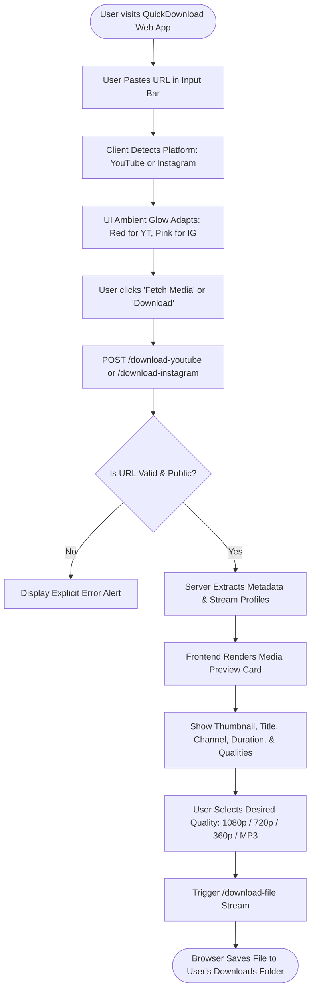
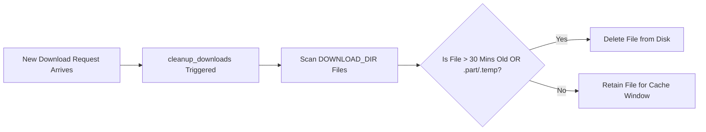

# QuickDownload - End-to-End User & Data Workflows

## 1. Primary User Journey

---

## 2. YouTube Media Extraction Workflow

1. **URL Normalization**:
   - The user inputs any standard URL variant (`youtube.com/watch?v=...`, `youtu.be/...`, or `youtube.com/shorts/...`).
   - The system parses the canonical 11-character video ID.
2. **Metadata Inspection**:
   - Server checks in-memory `METADATA_CACHE`. If cached, returns immediately (< 50ms).
   - If not cached, `yt-dlp` extracts format manifests, thumbnails, view counts, and uploader profile.
3. **Stream Prioritization**:
   - **Combined 720p**: If single progressive stream exists, direct streaming is prepared.
   - **Full HD 1080p**: Background thread fetches DASH streams and merges with audio via FFmpeg `-c copy`.
   - **MP3 Audio**: Extracts best audio track, adds ID3 metadata tags, and packages as standard MP3.
4. **Binary Delivery**:
   - Streams directly to the user's browser with sanitized content filenames.

---

## 3. Instagram Media Extraction Workflow

1. **Reel / Video Detection**:
   - Validates URL pattern against Instagram Reel (`/reel/`, `/reels/`) and Post (`/p/`) schemas.
2. **Media Extraction**:
   - Passes ephemeral session cookies (if present) to query Instagram's Graph/Web endpoints.
   - Resolves the direct progressive CDN MP4 video container.
3. **Packaging & Delivery**:
   - Downloads the progressive MP4 container into `DOWNLOAD_DIR`.
   - Generates download URL and streams file to client.

---

## 4. Background Storage Garbage Collection Workflow

- **Frequency**: Triggered on every incoming extraction request and during startup.
- **Rules**:
  - Files older than 30 minutes (`1800s`) are unlinked.
  - Temporary fragment artifacts (`.part`, `.ytdl`, `.temp`) are immediately swept.
